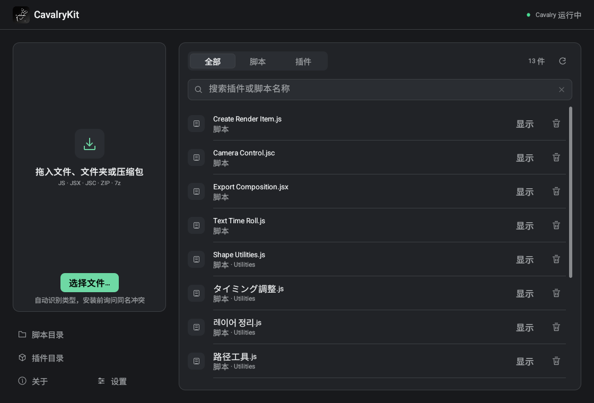
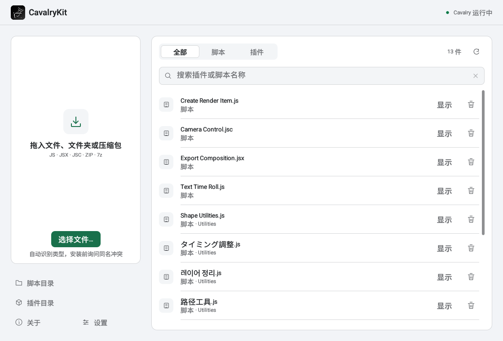
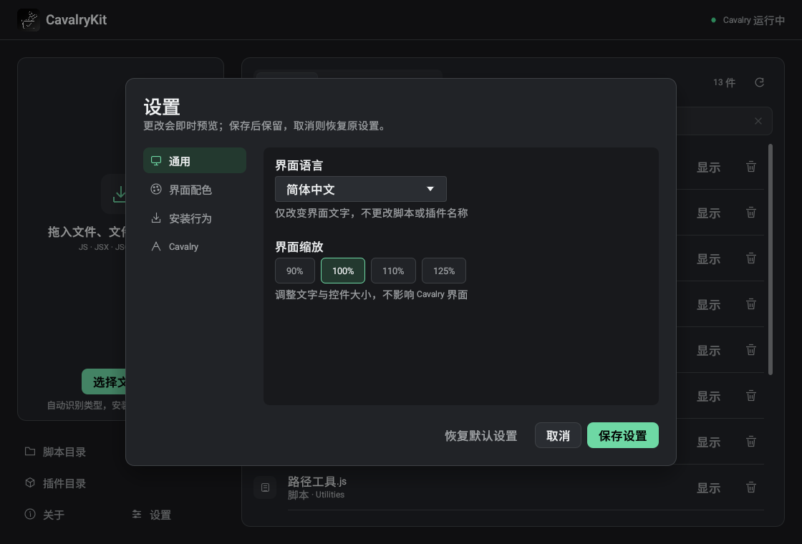

# CavalryKit 0.1.1

本地 Cavalry 脚本 / 插件安装与管理工具，支持 **macOS Apple Silicon 与 Windows x64**。
Cavalry 风格深灰界面，支持 **简体中文 / English / 日本語 / 한국어**。不会上传导入内容，也不会执行导入的脚本。



<details>
<summary>查看明亮主题（同一布局）</summary>



</details>

## 下载与升级

**当前为 0.1.1 待发布候选。** 下列产物已纳入本地交付流程；v0.1.1 Release 尚未创建。正式发布后从仓库 Releases 下载，使用 `SHA256SUMS.txt` 核对完整性。

| 平台 | 文件 | 安装 / 升级 |
|---|---|---|
| macOS Apple Silicon | `CavalryKit-0.1.1-mac-arm64.dmg` | 退出旧版，将 `CavalryKit.app` 拖入「应用程序」，替换原应用，再推出旧镜像 |
| Windows x64 | `CavalryKit-0.1.1-win-x64.zip` | 完整解压，关闭 CavalryKit，再运行 `Install-CavalryKit.cmd` |

Windows 安装到 `%LOCALAPPDATA%\Programs\CavalryKit\CavalryKit.exe`，快捷方式指向固定路径和 EXE 内嵌图标。再次安装会原位更新，旧 EXE 压缩备份保存到 `%LOCALAPPDATA%\CavalryKit\Backups`，不创建并排版本目录。其他位置自行解压的便携版不会被擅自删除，请自行归档；旧任务栏固定图标可取消固定后，从新快捷方式重新固定。

macOS 是 **ad-hoc 签名、未公证**，Windows **没有商业代码签名证书**。首次打开可能出现系统安全提示，工具不会禁用系统安全机制。

## 本版重点

- **更少 UI 阻塞**：识别、解压、复制、扫描、卸载和进程检查在后台串行执行；原生文件选择使用异步窗口。
- **Windows 针对性处理**：用原生进程枚举代替反复启动 `tasklist`；保留系统原生窗口标题栏；默认 wgpu 渲染，另有 Glow 兼容模式。
- **大型库性能**：缓存搜索索引、只绘制可见条目、长名称一次截断排版；结果分页以限制单帧工作量。
- **保留熟悉布局**：左侧拖入与目录入口，右侧列表顶部放置「全部 / 脚本 / 插件」和搜索；移除重复标题，保留克制的灰阶与绿色。
- **深浅主题与动效**：白卡片 / 浅灰底和分层深灰独立设计；固定控件边界，短暂悬停 / 按下 / 筛选 / 拖入过渡，开启「减少界面动效」后立即切换，空闲不循环重绘。
- **区域字体**：Roboto 拉丁字形 + 按语言选择的 Noto-derived SC / JP / KR，内嵌 Regular / Medium 两种字重，避免用日文字形替代简体中文 UI。
- **一致的界面**：右对齐弹窗操作、4/8/16/24pt 基础间距、标题同行状态、明确的取消入口、可见滚动条和键盘焦点。
- **安全安装**：同名内容先询问；覆盖前暂存，失败保留/恢复旧内容；同批重名、重复保留两者和重新导入自身均有回归测试。
- **双端图标**：原图保留；Mac ICNS 配标准/Retina 图标和光学留边，Windows ICO 有 15 档尺寸。

## 使用教程

1. 将 `.jsc` / `.js` / `.jsx`、插件目录或受支持压缩包拖进窗口，或点击「选择文件…」。
2. 同名冲突时选择「覆盖 / 保留两者 / 跳过」，也可取消本批。危险操作不会由 Enter 自动接受；默认始终询问。
3. 在独立结果弹窗查看成功、跳过或失败。失败会给出通用检查建议；展开「技术详情」可查看原始诊断。
4. 成功安装后，可以选择现在重启/打开 Cavalry，或稍后自行处理。**先保存 Cavalry 工程**：程序只发送正常退出请求，不强制终止进程。若出现保存提示，请到 Cavalry 处理；取消、超时、多实例或异常时不会强杀，也不会额外启动第二个实例。
5. 装备库可按类型筛选，按名称/分组/作者搜索；「显示」定位文件，「卸载」确认后移入废纸篓 / 回收站。
6. 外部更改文件后点击「刷新」，或启用返回窗口自动刷新。

**压缩包格式**：ZIP、7z、TAR、TAR.GZ / TGZ、TAR.BZ2 / TBZ2。含 `definitions.json` 的目录被视为插件；混合包中的独立脚本与插件分别安装。过滤 macOS 常见垃圾文件、拒绝路径穿越。只安装可信来源的内容。

### 设置



左侧底部与「关于」并排的「设置」分为 **通用 / 界面配色 / 安装行为 / Cavalry** 四页：

- 界面语言：中 / 英 / 日 / 韩；**不修改文件名称或脚本内容**。
- 配色：Cavalry 深灰、明亮、自定义强调色与背景色；文字对比度自动适配。
- 界面缩放：90% / 100% / 110% / 125%；减少动效。
- 重启提示：所有成功安装、仅插件成功安装、不提示。
- 返回窗口时自动刷新。
- 可选 Cavalry 程序位置：留空自动寻找；已运行时始终重新打开原实例对应程序。

更改即时预览；「取消」恢复原设置，「保存设置」后才持久保留。设置仅在本机 `CavalryKit/preferences.json` 中保存，写入失败保留原文件。

快捷键：`Cmd/Ctrl+F` 搜索，`Cmd/Ctrl+O` 选择文件，`Cmd/Ctrl+R` 刷新，`Cmd/Ctrl+,` 设置，`Esc` 取消/关闭弹窗（不会接受覆盖或重启）。

| 平台 | 脚本目录 | 插件目录 |
|---|---|---|
| macOS | `~/Library/Application Support/Cavalry/Scripts` | `~/Library/Application Support/Cavalry/Third-Party/Plugins` |
| Windows | `%APPDATA%\Cavalry\Scripts` | `%APPDATA%\Cavalry\Third-Party\Plugins` |

### Windows 显卡兼容模式

若旧 GPU / 驱动无法初始化默认后端，可在安装目录打开命令行：

```bat
set CAVALRYKIT_RENDERER=glow
CavalryKit.exe
```

Windows 静态链接 VC++ 运行库。实际流畅度仍受驱动、显示设置、输入规模和文件系统影响，不承诺所有环境零卡顿。

## 验证范围

- 自动测试覆盖引擎、失败回滚、背景任务、偏好保存、多语言字形、布局、对比度、图标及安全重启状态机。
- 原生 macOS / Windows CI 定义在 `.github/workflows/desktop.yml`；工作流尚未推送执行，不能记为通过。Windows CI 计划执行安装、原位更新、快捷方式图标、备份和文件锁失败路径测试。
- macOS 本机检查实际导入、结果、稍后重启、设置与多语言交互。
- **Windows 真实 Cavalry、GPU/多屏拖窗、混合 DPI 和任务栏缓存体验验收仍延期**；CI 和交叉编译不能替代它。自动安全重启测试使用模拟进程，不对用户未保存的工程执行重启。
- UI 采用尼尔森启发式复查，不是第三方认证或用户研究。见 [UI 复查记录](packaging/UI_REVIEW.md) 和 [验证清单](packaging/VALIDATION.md)。

## 开发与打包

```bash
cargo fmt --check
cargo clippy --all-targets --all-features --locked -- -D warnings
cargo test --all-targets --all-features --locked
cargo run --locked
cargo run --locked --example import_icon
cargo run --locked --features ui-preview --example ui_preview -- private/previews
```

默认测试只用合成数据与临时目录。真实 Cavalry 目录测试 `real_env_roundtrip` 默认忽略，不要无差别运行 ignored 测试。
图标原始素材为 `assets/icon-source.ico`；UI 预览功能不进入正常构建。打包见 [打包说明](packaging/README-打包.md)，变更见 [CHANGELOG](CHANGELOG.md)。真实截图、日志、用户工程和本地交接记录不上传。

---

## English

**CavalryKit 0.1.1** is a local installer and library manager for Cavalry scripts/plugins, targeting macOS Apple Silicon and Windows x64. It offers Chinese, English, Japanese and Korean UI, a Cavalry-inspired dark theme, a light theme and custom colors.

### Quick start

On macOS, quit the old app and replace `CavalryKit.app` in Applications. On Windows, fully extract the ZIP and run `Install-CavalryKit.cmd`; use the fixed desktop/Start menu shortcuts afterward. Existing portable copies elsewhere are not deleted automatically.

Drop scripts, plugin folders or supported archives into the window. Resolve name conflicts, then inspect the result dialog. You may restart Cavalry now or later. **Save your project first.** Only a normal quit is requested; cancellation/timeouts never force-close the app, and multiple running instances require manual handling. A running app reopens its original executable, not a different configured version.

The redesigned interface uses a compact library sidebar, right-hand list filters, quieter list actions, and four settings pages. Search reads “Search plugins or scripts by name”. Roboto is paired with region-specific SC/JP/KR UI subsets at regular/medium weights.

Settings include language, color scheme, custom accent/background, 90–125% scale, reduced motion, refresh-on-focus and restart-prompt policy. Changes preview immediately; Cancel reverts them, Save persists them locally. Conflicts and removal confirmations remain mandatory safety controls. Imported scripts are not executed or uploaded.

The library uses cached filtering and virtualized rows. I/O runs in a serialized background worker. Windows uses native process enumeration, embedded multi-size icons and static VC++ runtime linking. `CAVALRYKIT_RENDERER=glow` selects an alternative rendering backend for older drivers.

**Release status:** 0.1.1 is a local release candidate; its GitHub Release has not been created. The native macOS/Windows CI workflow is prepared but has not run remotely.

**Verification boundary:** Physical Windows/Cavalry, GPU/mixed-DPI and taskbar interaction checks are deferred; automated CI and cross-compilation are not equivalent to those tests. Restart state-machine tests use simulated processes and never close a user's unsaved project. macOS uses ad-hoc signing without notarization; Windows is not commercially code-signed.

For learning purposes only. Not affiliated with Scene Group.
